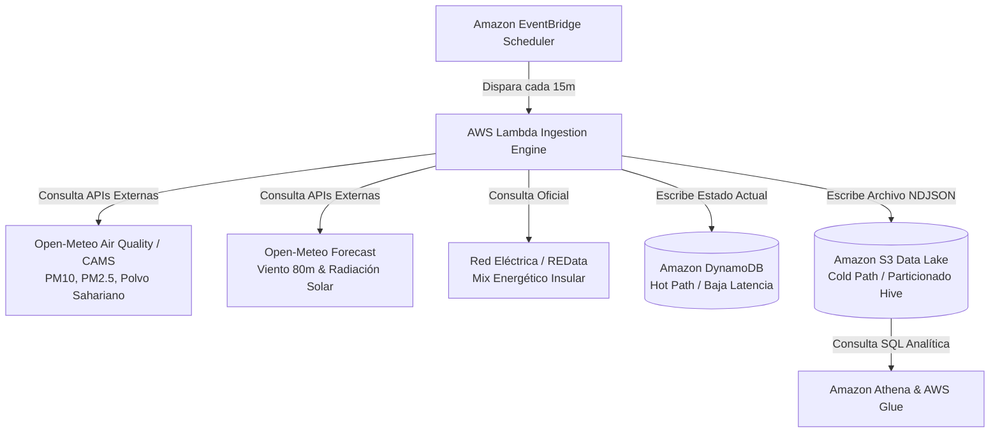

# ⚡ Canarias Energy & Calima Real-Time Monitor (AWS Serverless Data Lake)


Plataforma desatendida y nativa en la nube diseñada para monitorizar en tiempo real el impacto de fenómenos meteorológicos extremos (como la **calima** y variaciones en los **alisios**) sobre los 6 sistemas eléctricos aislados de las Islas Canarias. 

El proyecto implementa una arquitectura **Serverless Event-Driven** combinada con un **Data Lake Medallion**, desplegada íntegramente mediante **Infraestructura como Código (IaC)**.

---

## 🏛️ Arquitectura del Sistema

El pipeline se ejecuta de forma automática cada 15 minutos sin requerir servidores ociosos (*Pay-as-you-go* absoluto):



---

## 🚀 Características Técnicas Destacadas

1. **Gemelo Físico en Tiempo Real por Isla:**
* Cruza la velocidad real del viento a **80 metros de altura** (altura del buje de los aerogeneradores en los parques de Gran Canaria y Tenerife) con curvas de potencia características.
* Modela el impacto del polvo sahariano (`saharan_dust_ug_m3`) aplicando un índice de atenuación sobre la eficiencia teórica de los parques solares fotovoltaicos.


2. **Camino Dual (Hot & Cold Path):**
* **Camino Caliente:** Actualiza una tabla en **Amazon DynamoDB** (diseñada con Clave Compuesta `island_id` + `timestamp`) para servir el estado actual en milisegundos a un frontend.
* **Camino Frío:** Almacena los históricos en **Amazon S3** estructurados bajo particionado estilo Hive (`raw/year=YYYY/month=MM/day=DD/`), optimizados para consultas analíticas masivas de bajo coste.


3. **Infraestructura 100% como Código (Terraform):**
* Cero *ClickOps* (configuración manual en consola). Toda la seguridad (`IAM` con políticas de mínimo privilegio), almacenamiento (`S3` con cifrado y bloqueo público estricto) y cómputo están versionados en código.


---

## 📂 Estructura del Repositorio

```text
canarias-energy-aws/
├── infra/
│   └── main.tf               # Definición completa de recursos en Terraform (S3, DynamoDB, IAM, Lambda, EventBridge)
├── src/
│   └── lambda_function.py    # Código Python nativo (orquestación, peticiones HTTP y conectores AWS boto3)
└── README.md

```

---

## ⚙️ Despliegue y Configuración

### 1. Prerrequisitos

* Tener instalado [AWS CLI](https://aws.amazon.com/cli/) configurado con tus credenciales (`aws configure`).
* Tener instalado [Terraform](https://www.terraform.io/).

### 2. Desplegar la Infraestructura

Clona el repositorio, navega a la carpeta de infraestructura y aplica el plan de Terraform:

```bash
cd infra
terraform init
terraform plan
terraform apply -auto-approve

```

---

## 📊 Ejemplo de Payload Generado

Cada 15 minutos, la función Lambda genera y almacena un snapshot con la siguiente estructura JSON unificada por isla:

```json
{
  "island_id": "gran_canaria",
  "timestamp": "2026-10-14T01:13:04.336Z",
  "island_name": "Gran Canaria",
  "calima_metrics": {
    "pm10_ug_m3": 17.7,
    "saharan_dust_ug_m3": 4.0,
    "calima_status": "LIMPIO"
  },
  "weather_renewables": {
    "cloud_cover_pct": 0,
    "wind_speed_80m_kmh": 25.2,
    "solar_ghi_w_m2": 0.0,
    "solar_diffuse_ratio": 0.0
  },
  "island_realtime_estimation_mw": {
    "estimated_demand_mw": 328.6,
    "estimated_wind_mw": 75.44,
    "instant_renewable_share_pct": 22.96
  }
}

```

---

## 🛠️ Stack Tecnológico

* **Cómputo:** AWS Lambda (Python 3.12, nativo con `urllib` y `boto3`)
* **Orquestación:** Amazon EventBridge Scheduler (Cron de 15 min)
* **Almacenamiento NoSQL:** Amazon DynamoDB (On-Demand / Pay-per-request)
* **Data Lake:** Amazon S3 (Object Storage optimizado)
* **Infraestructura:** Terraform (HashiCorp)


