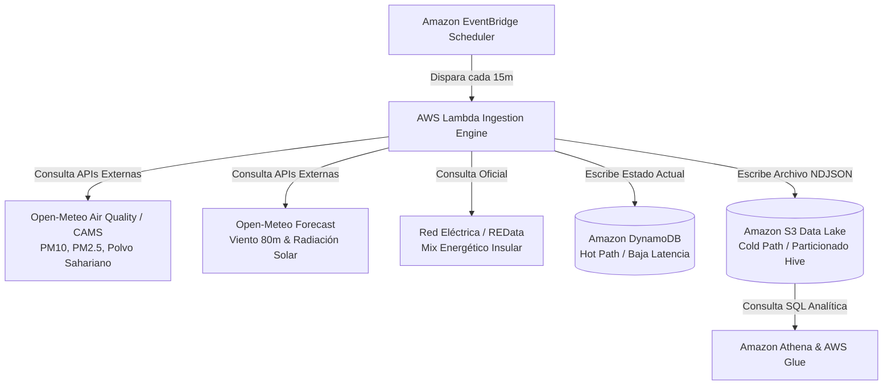

# ⚡ Canarias Energy & Calima Real-Time Monitor (AWS Serverless Data Lake)

[](https://github.com/yonillo/canarias-energy-aws/actions/workflows/ci.yml)


Plataforma desatendida y nativa en la nube diseñada para monitorizar en tiempo real el impacto de fenómenos meteorológicos extremos (como la **calima** y variaciones en los **alisios**) sobre los 6 sistemas eléctricos aislados de las Islas Canarias. 

El proyecto implementa una arquitectura **Serverless Event-Driven** combinada con un **Data Lake Medallion**, desplegada íntegramente mediante **Infraestructura como Código (IaC)**.

---

## 🏛️ Arquitectura del Sistema

El pipeline se ejecuta de forma automática cada 15 minutos sin requerir servidores ociosos (*Pay-as-you-go* absoluto):



---

## 🚀 Características Técnicas Destacadas

1. **Gemelo Físico en Tiempo Real por Isla:**
   * Cruza la velocidad real del viento a **80 metros de altura** (altura del buje de los aerogeneradores en los parques de Gran Canaria y Tenerife) con curvas de potencia características (cut-in: 11 km/h, nominal: 45 km/h, corte por seguridad: >90 km/h).
   * Modela el impacto del polvo sahariano (`saharan_dust_ug_m3`) aplicando un índice de atenuación sobre la eficiencia teórica de los parques solares fotovoltaicos.

2. **Camino Dual (Hot & Cold Path):**
   * **Camino Caliente (DynamoDB):** Almacena el último estado conocido por isla con clave compuesta (`island_id` + `timestamp`), optimizado con conversión transparente a `Decimal` para consultas sub-10ms en frontends.
   * **Camino Frío (S3 Data Lake):** Persiste archivos NDJSON bajo particionado estilo Hive (`raw/year=YYYY/month=MM/day=DD/`), optimizados para consultas federadas masivas de bajo coste en Athena.

3. **Infraestructura 100% como Código (Terraform):**
   * Cero *ClickOps*. Toda la seguridad (`IAM` con políticas de mínimo privilegio), cifrado en reposo (`SSE-S3`), ciclos de vida (`Lifecycle Rules` hacia `STANDARD_IA` y `GLACIER`), DynamoDB on-demand y cómputo están versionados y parametrizados.

4. **Zero-Dependency Runtime:**
   * La función Lambda se apoya exclusivamente en `urllib.request`, `json` y `boto3` nativo, permitiendo artefactos zip ultra ligeros (< 20 KB) sin necesidad de empaquetar capas externas ni dependencias pesadas.

---

## 📂 Estructura del Repositorio

```text
canarias-energy-aws/
├── .github/
│   └── workflows/
│       └── ci.yml               # CI automatizado (tests unitarios y validación Terraform)
├── analytics/
│   └── athena_queries.sql       # DDL de Glue Data Catalog y consultas SQL analíticas
├── infra/
│   ├── main.tf                  # Recursos AWS (S3, DynamoDB, IAM, Lambda, EventBridge)
│   ├── variables.tf             # Variables de parametrización (región, entorno)
│   └── outputs.tf               # Outputs exportados (ARNs, buckets, nombres de tablas)
├── src/
│   └── lambda_function.py       # Motor de ingesta, cálculo físico y conectores AWS
├── tests/
│   └── test_simulation.py       # Tests unitarios del modelo físico y serialización
└── README.md
```

---

## ⚙️ Despliegue y Configuración

### 1. Prerrequisitos

* Tener instalado [AWS CLI](https://aws.amazon.com/cli/) configurado con tus credenciales (`aws configure`).
* Tener instalado [Terraform](https://www.terraform.io/) (>= 1.5.0).
* Python 3.12+ (opcional para pruebas y tests locales).

### 2. Desplegar la Infraestructura

Clona el repositorio, navega a la carpeta de infraestructura y aplica el plan de Terraform:

```bash
cd infra
terraform init
terraform plan
terraform apply -auto-approve
```

### 3. Ejecutar Tests Unitarios Locales

El proyecto cuenta con una suite de pruebas para verificar las curvas aerodinámicas, límites de seguridad de turbinas y factores de atenuación solar:

```bash
python -m unittest discover tests
```

---

## 📊 Ejemplo de Payload Generado

Cada 15 minutos, la función Lambda genera y almacena un snapshot con la siguiente estructura unificada por cada isla:

```json
{
  "island_id": "gran_canaria",
  "timestamp": "2026-10-14T02:04:43.325029+00:00",
  "island_name": "Gran Canaria",
  "coordinates": {
    "lat": 27.85,
    "lon": -15.43
  },
  "calima_metrics": {
    "pm10_ug_m3": 18.0,
    "pm2_5_ug_m3": 10.1,
    "saharan_dust_ug_m3": 5.0,
    "aerosol_optical_depth": 0.16,
    "european_aqi": 30,
    "calima_status": "LIMPIO"
  },
  "weather_renewables": {
    "temp_c": 23.0,
    "cloud_cover_pct": 0,
    "wind_speed_10m_kmh": 25.1,
    "wind_speed_80m_kmh": 25.2,
    "wind_dir_deg": 21,
    "solar_ghi_w_m2": 0.0,
    "solar_direct_w_m2": 0.0,
    "solar_diffuse_w_m2": 0.0,
    "solar_diffuse_ratio": 0.0
  },
  "derived_features": {
    "calima_solar_attenuation_index": 5.0
  },
  "island_realtime_estimation_mw": {
    "estimated_demand_mw": 328.6,
    "estimated_wind_mw": 75.44,
    "estimated_solar_mw": 0.0,
    "estimated_fossil_backup_mw": 253.16,
    "instant_renewable_share_pct": 22.96,
    "wind_capacity_factor": 0.247,
    "solar_calima_efficiency_factor": 0.995
  },
  "ree_canarias_consolidated_mix": {
    "Ciclo combinado": { "mwh_day": 9472.06, "share_pct": 35.34 },
    "Eólica": { "mwh_day": 6307.8, "share_pct": 23.53 },
    "Motores diésel": { "mwh_day": 4924.21, "share_pct": 18.37 },
    "Turbina de vapor": { "mwh_day": 4302.83, "share_pct": 16.05 },
    "Solar fotovoltaica": { "mwh_day": 1014.39, "share_pct": 3.78 }
  }
}
```

---

## 📈 Consultas Analíticas en Amazon Athena

En la carpeta [`analytics/athena_queries.sql`](file:///analytics/athena_queries.sql) se incluye el DDL para registrar la tabla en el catálogo de AWS Glue y consultas para explotar el Data Lake:

* **Degradación de eficiencia solar por nivel de calima:** Correlación entre partículas en suspensión y caída de generación fotovoltaica.
* **Respaldo térmico vs penetración renovable:** Análisis horario del hueco térmico que deben cubrir los grupos fósiles en cada isla.
* **Curva de potencia en alisios:** Rendimiento de los parques eólicos insulares agrupados por tramos de velocidad del viento a 80 metros.

---

## 🛠️ Stack Tecnológico

* **Cómputo:** AWS Lambda (Python 3.12, nativo con `urllib` y `boto3`)
* **Orquestación:** Amazon EventBridge (Regla cron cada 15 min)
* **Almacenamiento NoSQL:** Amazon DynamoDB (On-Demand / Pay-per-request)
* **Data Lake:** Amazon S3 (Particionado Hive, SSE-AES256, Lifecycle Transition)
* **Analítica:** Amazon Athena & AWS Glue Data Catalog
* **Infraestructura como Código:** Terraform (HashiCorp)
* **CI/CD:** GitHub Actions (Linting, Unit Tests & Terraform Validate)
